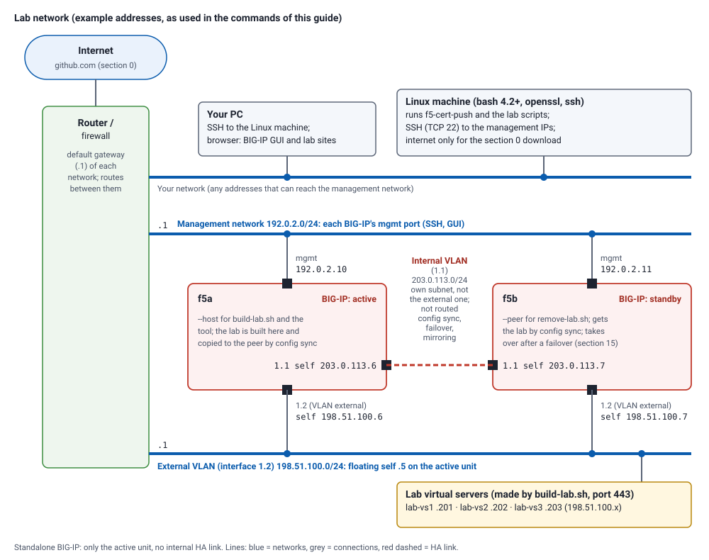

# Lab: learn f5-cert-push on a lab BIG-IP

A hands-on lab, from nothing to a renewed certificate on an HA pair. You build a small, disposable lab on a
**lab** BIG-IP with one script, then set up and use the tool exactly as you would the first time in production:
install it, create its SSH key, save the certificate files you were sent, discover the BIG-IP, write the
configuration, deploy, see what it refuses, roll back. One more script removes every lab item again, also if
you stop half way, so the lab can be run as often as you like.

> **Use a lab BIG-IP.** The lab only creates and removes objects named `lab-*`, and the tool only changes the
> profiles you configure, but an HA pair is synchronised during the lab (config-sync copies the whole
> configuration). Start with the pair **In Sync**.

| | |
|---|---|
| Time | about 45 minutes (an extra 10 for the HA-only sections) |
| Works with | a standalone BIG-IP, or an active/standby pair in a sync-failover device group (both tested on 17.1) |

### The lab network



The addresses in this guide are **examples** from the ranges reserved for documentation (RFC 5737), so none of
them is a real address. Use your own in their place:

| Example in this guide | What it is | Used as |
|---|---|---|
| `192.0.2.10` | management IP of the **active** BIG-IP (`f5a`) | what you give `build-lab.sh` first; `A` in `lab-env.sh` (section 1), `host =` in the configuration |
| `192.0.2.11` | management IP of the **standby** BIG-IP (`f5b`; none for a standalone BIG-IP) | what you give `build-lab.sh` second; `B` in `lab-env.sh` (`remove-lab.sh --cleanup` reads it) |
| `198.51.100.0/24` | the BIG-IPs' **external** VLAN (interface 1.2); floating self IP `.5`, unit self IPs `.6` and `.7` | where `build-lab.sh` puts the lab virtual servers |
| `198.51.100.201`-`.203` | the lab virtual servers `lab-vs1`-`lab-vs3` (port 443) | `VS1`-`VS3` in `lab-env.sh`; `build-lab.sh` picks them and writes them to `lab-info.txt` |

The tool and the lab scripts only ever connect to the **management** IPs, over SSH (TCP 22), from the Linux
machine. The PC needs nothing installed: it is where you SSH to the Linux machine from, and where a browser can
open the BIG-IP GUI and the lab sites.

**The internal VLAN (the server side) is not affected.** Neither the lab scripts nor f5-cert-push create, change
or remove VLANs, self IPs, routes, pools or backend servers. The lab's virtual servers have no pool: they only
present a certificate, which is all the lab needs. When `build-lab.sh` shows its plan, check that the virtual
server addresses are on the external (client-side) subnet: it takes them from the BIG-IP's first `/24` self IP,
and if that is an internal one, answer `n` and run it again with `--vs-ips A,B,C`.

### The lab scripts

| Script | What it does | Download |
|---|---|---|
| `build-lab.sh` | Builds the lab on a BIG-IP or HA pair, and sets up the tool's SSH key (section 1) | [from this copy](../lab/build-lab.sh) · [from GitHub](https://raw.githubusercontent.com/lothortech/f5-cert-push/v2.2.3/lab/build-lab.sh) |
| `remove-lab.sh` | Removes every lab item from both units and this machine, at any point: `--cleanup` (section 16) | [from this copy](../lab/remove-lab.sh) · [from GitHub](https://raw.githubusercontent.com/lothortech/f5-cert-push/v2.2.3/lab/remove-lab.sh) |

They are also in the release (`lab/`), which section 0 downloads anyway, and both have `--help`. To fetch
only the scripts onto a Linux machine:

```bash
curl -fsSLO https://raw.githubusercontent.com/lothortech/f5-cert-push/v2.2.3/lab/build-lab.sh
curl -fsSLO https://raw.githubusercontent.com/lothortech/f5-cert-push/v2.2.3/lab/remove-lab.sh
chmod +x build-lab.sh remove-lab.sh
```

## 0. Download the files

Everything is in the GitHub repository [lothortech/f5-cert-push](https://github.com/lothortech/f5-cert-push):
the tool, the lab scripts, the documentation (Markdown, and HTML in `html/`), the examples and the tests. Download
the **v2.2.3** release onto the Linux machine you will run the lab from, in one of these ways. Each gives the same
files in `~/f5-cert-push`.

**With curl** (or `wget -qO-` in place of `curl -fsSL`):

```bash
mkdir -p ~/f5-cert-push && cd ~/f5-cert-push
curl -fsSL https://github.com/lothortech/f5-cert-push/archive/refs/tags/v2.2.3.tar.gz | tar xz --strip-components=1
```

**With git:**

```bash
git clone --depth 1 --branch v2.2.3 https://github.com/lothortech/f5-cert-push.git ~/f5-cert-push
cd ~/f5-cert-push
```

(git notes that it is on a "detached HEAD": expected, as this is a release tag rather than a branch.)

**Without internet access on the Linux machine:** on a PC, download
[f5-cert-push-2.2.3.tar.gz](https://github.com/lothortech/f5-cert-push/archive/refs/tags/v2.2.3.tar.gz)
or [f5-cert-push-2.2.3.zip](https://github.com/lothortech/f5-cert-push/archive/refs/tags/v2.2.3.zip), copy it across (`scp`, a share), then:

```bash
mkdir -p ~/f5-cert-push && cd ~/f5-cert-push
tar xzf /path/to/f5-cert-push-2.2.3.tar.gz --strip-components=1
```

From the ZIP instead (it unpacks into `f5-cert-push-2.2.3/` and loses the execute bits):

```bash
cd ~ && unzip -q /path/to/f5-cert-push-2.2.3.zip
mkdir -p ~/f5-cert-push && cp -a ~/f5-cert-push-2.2.3/. ~/f5-cert-push/ && rm -rf ~/f5-cert-push-2.2.3
cd ~/f5-cert-push && find . -name '*.sh' -exec chmod +x {} +
```

Check the download (every file against `SHA256SUMS`; silence means all match) and the version:

```bash
sha256sum -c --quiet SHA256SUMS && echo "all files OK"
./f5-cert-push.sh --version
```

You now have `f5-cert-push.sh` and `f5-cert-install.sh` (the tool), `lab/` (the two lab scripts), `docs/` and
`html/` (this guide and the rest), `examples/`, `tests/`, and `f5-cert-push.conf.example`.

## 1. Build the lab (it also sets up the tool's SSH access)

You need a Linux machine (bash 4.2+, `openssl`, `ssh`, `tar`; OpenSSL 1.1 or newer for this lab) that can reach
the BIG-IP management addresses on TCP 22, with **root SSH access to the BIG-IP** (a key, or the root password),
and three unused addresses for the lab's virtual servers. By default the script picks `.201`-`.203` (or the next
free ones) in the subnet of the BIG-IP's first IPv4 `/24` self IP; give `--vs-ips A,B,C` otherwise.

From the folder you downloaded in section 0. **Run on: the Linux machine**:

```bash
cd ~/f5-cert-push
./lab/build-lab.sh
```

It asks for the **management IP of the active BIG-IP**, then of the **standby** one (press Enter for a standalone
BIG-IP). Before it logs in anywhere, it shows each unit's SSH **host key fingerprint** and asks whether it matches
the one the BIG-IP itself shows: on the BIG-IP's console (or an SSH session you already trust), as root in bash,
`ssh-keygen -lf /config/ssh/ssh_host_ecdsa_key.pub`. This is what tells you that you are typing your password into
the real BIG-IP. Then it logs in to each with **your own** root access: with a password, you type it once per unit (an HA
pair synchronises the root password, so it is the same on both). Add `--key FILE` if that access uses a specific
key. It checks the BIG-IPs (active and standby, configuration loaded, no lab items yet; for a pair, In Sync),
shows the plan and asks before changing anything. Then it:

| Does | |
|---|---|
| SSH, on this machine | pins each unit's **host key** in `~/.ssh/known_hosts` (once you confirmed its fingerprint), and creates the **tool's key** `~/.ssh/f5_push_ecdsa` (comment `f5-cert-push-lab`; an existing lab key is reused) |
| SSH, on each BIG-IP | authorises the tool's public key for root in `/var/ssh/root/authorized_keys`, then tests a login with it |
| on the BIG-IP | `lab-vs1`, `lab-vs2`, `lab-vs3` (port 443) using the client-ssl profiles `lab-app1-clientssl`, `lab-app2-clientssl` and `lab-wild-clientssl`; the last holds **two** certificates, an RSA (`rsa` entry) and an ECDSA (`ecdsa` entry) one for `*.lab.test`. Plus `lab-spare.crt` and `lab-legacy.crt`, used by no profile. Today's certificates expire in 60 days. For a pair, the device group is synchronised. |
| on this machine | `~/f5-cert-push-lab/`: the lab CA, `lab-info.txt` (addresses and names), `lab-env.sh` (the addresses for this guide's commands), and `received/`: the **renewed** certificates, as a CA sends them (`received/app1/app1.lab.test.crt` + `.key` + `intermediate.crt`, `received/app2/app2.lab.test.pfx`, ...), and some bad ones in `received/bad/`. |

It makes **no** f5-cert-push configuration or folders: that is what the rest of the lab is for.

If `~/f5-cert-push-lab` is left from an earlier run, the build says what it holds (when and for which BIG-IP it
was built, or that a build stopped half way) and offers to replace it; it is deleted only once you confirm the
new build. If that lab may still be on the BIG-IPs, answer `n` and run `./lab/remove-lab.sh --cleanup` first.

**Load the addresses** the rest of this guide uses (`A`, `B`, `VS1`-`VS3`), and look at the summary. Do this again
in every new terminal. **Run on: the Linux machine**:

```bash
. ~/f5-cert-push-lab/lab-env.sh
echo "A=$A B=$B VS1=$VS1 VS2=$VS2 VS3=$VS3"
cat ~/f5-cert-push-lab/lab-info.txt
```

## 2. The tool's SSH access: what the script did for you

f5-cert-push does all its work over SSH: it logs in to each BIG-IP's management address as **root**, with a key
of its own. The build set that up; in production you do it by hand, once (User guide, sections 3-4, or Setup
guide, section 5). The steps, and where each runs:

| Step | Runs on | By hand it is |
|---|---|---|
| Pin each unit's **host key**: the BIG-IP's own key, which proves it is the real BIG-IP | Linux machine (compare on the BIG-IP) | `ssh-keyscan -t ecdsa $A >> ~/.ssh/known_hosts`; on the BIG-IP `ssh-keygen -lf /config/ssh/ssh_host_ecdsa_key.pub` shows the fingerprint to compare |
| Create **the tool's key**, never on the BIG-IP | Linux machine | `ssh-keygen -t ecdsa -b 384 -N '' -C f5-cert-push-lab -f ~/.ssh/f5_push_ecdsa` (ECDSA: BIG-IP refuses ed25519) |
| Authorise its **public** half on **each** unit (this file is not synchronised by an HA pair) | each BIG-IP, as root | append the `.pub` line to `/var/ssh/root/authorized_keys`, then `chmod 600` and `restorecon` that file |

Try the login exactly as the tool will make it: no password prompt, and one unit says active, the other standby.
**Run on: the Linux machine**:

```bash
for h in $A $B; do ssh -i ~/.ssh/f5_push_ecdsa -o IdentitiesOnly=yes -o BatchMode=yes root@$h 'uname -n; tmsh show sys failover | head -1'; done
```

The comment `f5-cert-push-lab` is how `remove-lab.sh` finds the key on each unit again at the end (section 16).

## 3. Read the documentation first (2 minutes)

`~/f5-cert-push/html/index.html` is the documentation as web pages (copy the `html/` folder to your desktop
and open it). Sections 5-6 of the **User guide** are what you do next (its sections 3-4, the SSH key, the build did
for you: section 2).

## 4. Save the certificate files you were sent

The tool wants three PEM files per certificate: the certificate, the chain (intermediates) and the private key.
Make one folder per certificate, private to you:

```bash
mkdir -p ~/certs/app1 ~/certs/app2 ~/certs/wildcard ~/certs/wildcard-ec && chmod 700 ~/certs ~/certs/*
R=~/f5-cert-push-lab/received
```

app1, the wildcard and the ECDSA wildcard came as PEM files with other names. A `.crt` or `.key` in PEM form
(text starting `-----BEGIN`) only needs a new name:

```bash
cp $R/app1/app1.lab.test.crt ~/certs/app1/cert.pem; cp $R/app1/app1.lab.test.key ~/certs/app1/privkey.pem; cp $R/app1/intermediate.crt ~/certs/app1/chain.pem
cp $R/wildcard/star.lab.test.crt ~/certs/wildcard/cert.pem; cp $R/wildcard/star.lab.test.key ~/certs/wildcard/privkey.pem; cp $R/wildcard/intermediate.crt ~/certs/wildcard/chain.pem
cp $R/wildcard-ec/star.lab.test-ecdsa.crt ~/certs/wildcard-ec/cert.pem; cp $R/wildcard-ec/star.lab.test-ecdsa.key ~/certs/wildcard-ec/privkey.pem; cp $R/wildcard-ec/intermediate.crt ~/certs/wildcard-ec/chain.pem
```

app2 came as a **PFX** bundle (password `lab`): split it into the three files (User guide, section 5.3):

```bash
openssl pkcs12 -in $R/app2/app2.lab.test.pfx -passin pass:lab -nocerts -nodes | openssl pkey -out ~/certs/app2/privkey.pem
openssl pkcs12 -in $R/app2/app2.lab.test.pfx -passin pass:lab -clcerts -nokeys | openssl x509 -out ~/certs/app2/cert.pem
openssl pkcs12 -in $R/app2/app2.lab.test.pfx -passin pass:lab -cacerts -nokeys | sed -n '/BEGIN CERT/,/END CERT/p' > ~/certs/app2/chain.pem
chmod 600 ~/certs/*/privkey.pem
```

## 5. Write the starting configuration: just the BIG-IPs

```bash
cat > ~/f5-cert-push/f5-cert-push.conf <<EOF
[defaults]
backup_dir_local = $HOME/f5-cert-push/backups
log_file         = $HOME/f5-cert-push/f5-cert-push.log
lock_dir         = $HOME/f5-cert-push/locks
chain_check      = fail
min_days_valid   = 7

[f5:bigip-a]
host    = $A
ssh_key = $HOME/.ssh/f5_push_ecdsa

[f5:bigip-b]
host    = $B
ssh_key = $HOME/.ssh/f5_push_ecdsa
EOF
chmod 600 ~/f5-cert-push/f5-cert-push.conf
cd ~/f5-cert-push
```

(Standalone BIG-IP: leave out `[f5:bigip-b]`.) The file sits next to the script, so no `--config` is needed.

## 6. Discover what is on the BIG-IPs (read-only)

```bash
./f5-cert-push.sh --discover
```

For each unit: active or standby; its device groups (`sync-failover`, In Sync); every client-ssl profile with
its certificate (CN, expiry), chain, key and the virtual server using it. `lab-wild-clientssl` appears twice
(entries `ecdsa` and `rsa`). At the end, **certificates not used by any client-ssl profile**: `lab-spare.crt` and
`lab-legacy.crt`. Anything else already on your BIG-IP is listed too.

## 7. Let the tool draft the configuration

```bash
./f5-cert-push.sh --discover --write-config draft.conf
less draft.conf
```

`draft.conf` is your file plus a `[cert:]` and a `[deploy:]` section for every certificate a profile uses: both
units in each deployment, `verify` lines from the virtual servers, and every deployment `enabled = no` until you
review it. It never overwrites a file: run the command again and see it refuse.

Point the four lab certificates at your files and enable **only** the lab deployments (anything else on your
BIG-IP stays disabled). By hand in an editor, or:

```bash
sed -i -e "s#/path/to/certs/lab-app1/#$HOME/certs/app1/#" -e "s#/path/to/certs/lab-app2/#$HOME/certs/app2/#" -e "s#/path/to/certs/lab-wild/#$HOME/certs/wildcard/#" -e "s#/path/to/certs/lab-wild-ec/#$HOME/certs/wildcard-ec/#" draft.conf
sed -i '/^\[deploy:lab-/,/^enabled/ s/^enabled = no/enabled = yes/' draft.conf
mv draft.conf f5-cert-push.conf && chmod 600 f5-cert-push.conf
```

## 8. Check the files and the configuration (no network)

```bash
./f5-cert-push.sh --validate
./f5-cert-push.sh --list
```

`--validate` checks each lab certificate (key match, chain, expiry, key type) and says which certificates it
did not check (those used only by disabled deployments).

## 9. Compare with the BIG-IPs (read-only)

```bash
./f5-cert-push.sh --check --all; echo "exit $?"
```

Exit 4: every lab profile is **OUT OF DATE**, on the standby too.

## 10. Rehearse, then deploy one certificate

```bash
./f5-cert-push.sh --deploy lab-app1-bigip-a --dry-run
./f5-cert-push.sh --deploy lab-app1-bigip-a
```

The summary shows `UPDATED ... synchronised to <the standby>` for the active unit and `IN_SYNC` for the standby.
(The deployment names end in the name of the unit that was active when you drafted them; `--list` shows them.
This guide assumes bigip-a.)
Look for yourself:

```bash
ssh -i ~/.ssh/f5_push_ecdsa root@$A "echo | openssl s_client -connect $VS1:443 2>/dev/null | openssl x509 -noout -subject -enddate; tmsh show cm sync-status | grep -E 'Status|Sync-Failover'"
ssh -i ~/.ssh/f5_push_ecdsa root@$B 'tmsh list ltm profile client-ssl lab-app1-clientssl cert-key-chain'
```

The new expiry is about 13 months out; the standby's profile uses the same new `lab-app1-cert-<time>.pem`.

## 11. Bad certificates are refused before anything is touched

`received/bad/` holds four bad sets. Try each with a small throwaway configuration (`bad.conf`, rewritten for
each one), aimed at the lab profile `lab-app1-clientssl`:

```bash
for b in expired wrong-key expires-soon encrypted-key; do
  cat > ~/f5-cert-push/bad.conf <<EOF
[defaults]
backup_dir_local = $HOME/f5-cert-push/backups
lock_dir         = $HOME/f5-cert-push/locks
chain_check      = fail
min_days_valid   = 7
[f5:bigip-a]
host    = $A
ssh_key = $HOME/.ssh/f5_push_ecdsa
[cert:bad]
cert  = $R/bad/$b/cert.pem
chain = $R/bad/$b/chain.pem
key   = $R/bad/$b/privkey.pem
object_prefix = lab-bad
[deploy:try-bad]
f5      = bigip-a
cert    = bad
profile = lab-app1-clientssl
EOF
  chmod 600 ~/f5-cert-push/bad.conf
  echo "=== $b"; ./f5-cert-push.sh --config bad.conf --deploy try-bad; echo "exit $?"
done
rm -f ~/f5-cert-push/bad.conf
```

Each is refused with its reason (`already expired`, `does not match the certificate`, `min_days_valid is 7`,
`passphrase-protected`), exit 1, **before connecting to the BIG-IP**: nothing is backed up or changed.

## 12. Deploy the rest in one run

```bash
./f5-cert-push.sh --all
./f5-cert-push.sh --check --all; echo "exit $?"
```

app2, the RSA wildcard and the ECDSA wildcard are `UPDATED` and synchronised (app1 is `UPTODATE`); then `--check`
exits 0. `lab-vs3` serves both renewed wildcards; its check asked for each key type:

```bash
ssh -i ~/.ssh/f5_push_ecdsa root@$A "for c in aRSA aECDSA; do echo | openssl s_client -connect $VS3:443 -cipher \$c 2>/dev/null | openssl x509 -noout -enddate -text | grep -E 'notAfter|Public Key Algorithm'; done"
```

## 13. Roll back, and forward again

```bash
./f5-cert-push.sh --deploy lab-app2-bigip-a --list-backups
```

Take the newest timestamp shown for bigip-a:

```bash
./f5-cert-push.sh --deploy lab-app2-bigip-a --f5 bigip-a --rollback --set TIMESTAMP
./f5-cert-push.sh --check --deploy lab-app2-bigip-a; echo "exit $?"
./f5-cert-push.sh --deploy lab-app2-bigip-a
```

`RESTORED ... synchronised` (the standby follows), then `--check` says OUT OF DATE (exit 4), and the last
command puts the renewal back.

## 14. An out-of-sync pair is refused (HA pair only)

Make an unsynchronised change on the active unit, then try to deploy:

```bash
ssh -i ~/.ssh/f5_push_ecdsa root@$A 'tmsh modify ltm profile client-ssl lab-app1-clientssl description "unsynced change"'
./f5-cert-push.sh --deploy lab-app1-bigip-a --force; echo "exit $?"
```

Refused, exit 1, nothing changed and no backup made: the device group is `Changes Pending`, and a sync would
copy that change too. Resolve it (here: sync it), then the same command works:

```bash
ssh -i ~/.ssh/f5_push_ecdsa root@$A 'tmsh run cm config-sync to-group Sync-Failover'
./f5-cert-push.sh --deploy lab-app1-bigip-a --force
```

(Your device group may have another name: `--discover` shows it.)

## 15. After a failover, nothing to edit (HA pair only, optional)

```bash
ssh -i ~/.ssh/f5_push_ecdsa root@$A 'tmsh run sys failover standby'
./f5-cert-push.sh --deploy lab-wild-bigip-a --force
ssh -i ~/.ssh/f5_push_ecdsa root@$B 'tmsh run sys failover standby'
```

The middle command now deploys to bigip-b (`UPDATED`) and checks bigip-a (`IN_SYNC`); the last fails back.

## 16. Remove the lab

`remove-lab.sh` finds and removes every lab item, whoever created it: the lab virtual servers, profiles,
certificates and keys (including every version the tool installed), the backup sets on each unit, and the
`f5-cert-push-lab` SSH key on each unit; then it synchronises the pair. With `--cleanup` it reads the addresses
from `~/f5-cert-push-lab/lab-env.sh` (nothing to type), finds the other unit of the pair by itself, and also
deletes, on this machine, the lab directory and the tool's lab key `~/.ssh/f5_push_ecdsa`. It works at any point
of the lab. Look first, then remove: it lists what it found on each BIG-IP and asks before it changes anything.
**Run on: the Linux machine**:

```bash
cd ~/f5-cert-push
./lab/remove-lab.sh --cleanup --dry-run
./lab/remove-lab.sh --cleanup
```

It asks `Remove these lab items from both BIG-IPs (...) and this machine? [y/N]` (one BIG-IP for a standalone
lab). If the lab directory is already gone, it asks for the active unit's address instead. If the lab was left
failed over, it finds the active unit itself. It reports, and leaves alone, anything of yours that uses a lab
item. If the pair was not In Sync before the removal, it does not synchronise (that would publish other pending
changes): the other unit then keeps its copy of the lab, and the script says so and exits 1. Check what else is
pending, then rerun with `--sync` (or sync the pair yourself).

If you quit half way, the same two commands clean up whatever you got to: the deployments you made, their
backups, a lock left by an interrupted run (add `--remove-stale`, when no f5-cert-push run is going on), and a
lab left failed over or out of sync.

Then remove the rest of what you made on this machine: the download, the certificate folders, and (optional) the
BIG-IPs' host keys the build pinned:

```bash
cd ~ && rm -rf ~/f5-cert-push ~/certs
for h in $A $B; do ssh-keygen -R $h; done
```

(`ssh-keygen -R` also forgets the BIG-IPs' host keys for your own logins; skip it if you use them otherwise. In a
new terminal `A` and `B` are not set: give the addresses instead.)

To run the lab again, start at section 0 (the line above removed the download too).
